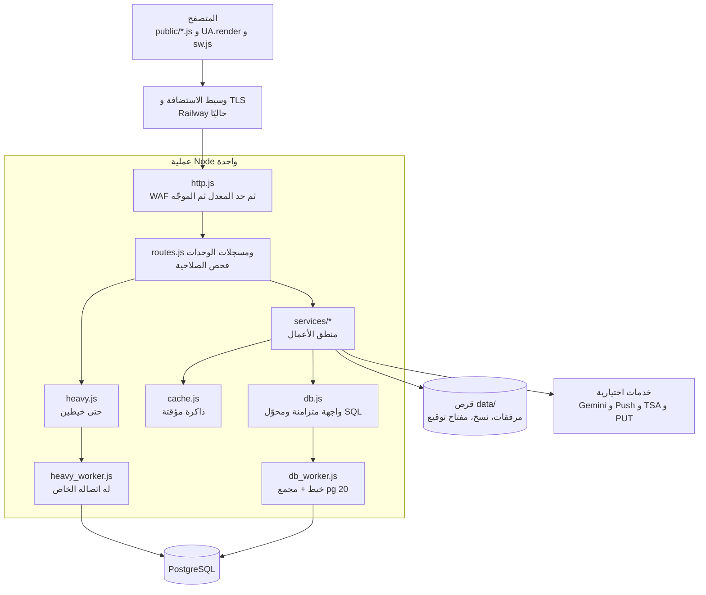
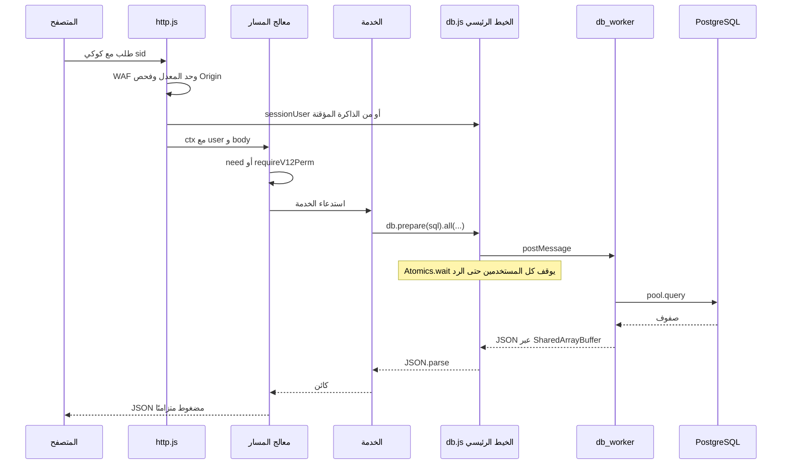

# 04. معمارية النظام

## التصنيف

**تطبيق موحد (Monolith) مقسم إلى وحدات جزئيًا، مع واجهة صفحة واحدة (SPA) مكتوبة دون إطار عمل، تتصل بواجهة JSON برمجية.** لا توجد خدمات مصغرة ولا تصيير من الخادم.

الخادم عملية Node واحدة ذات حالة في الذاكرة: جلسات مخبأة وحدود معدل وسجل WAF وآخر بصمة تدقيق. لذلك لا يمكن تشغيل نسختين منه بأمان دون إعادة تصميم هذه الأجزاء.

## المخطط العام

## دورة الطلب

## الطبقات

| الطبقة | الموقع | المسؤولية | التقييم |
|---|---|---|---|
| العرض | `public/*.js`، `style.css` | قوالب HTML نصية و`innerHTML` | ملفات ضخمة، ومنطق عرض ممزوج ببيانات |
| تطبيق الواجهة | `app.js`، `boot.js`، `shell.js`، `ux_*.js` | الحالة والتنقل والتحسينات | طبقات تعديل متراكمة بعد الرسم |
| الاتصال | `api()` في `app.js`، و`http.js` | REST بصيغة JSON | لا عقد ولا إصدار للواجهة |
| الهوية والتفويض | `auth.js`، `permissions.js`، `need()` | الجلسة والصلاحيات | جيد عمومًا، وطريقة الفحص غير موحدة |
| منطق الأعمال | `server/services/*` | القواعد | جزء منه داخل المعالجات مباشرة |
| الوصول إلى البيانات | `db.js`، و`db.prepare` في كل مكان | SQL خام | لا طبقة مستودعات |
| قاعدة البيانات | PostgreSQL | التخزين | 134 جدولًا، انظر 05 |
| البنية التحتية | Docker وRailway | التشغيل | عملية واحدة |
| التكامل | `push.js`، `backup.js`، `enrollcert.js`، `v12_modules.js` | خدمات خارجية | اختيارية |

## فصل المسؤوليات

### وصول مباشر إلى قاعدة البيانات من طبقة غير مناسبة

`db.prepare` يُستدعى داخل معالجات المسارات، لا في الخدمات فقط: `routes.js` و`v12_modules.js` و`enterprise_suite.js`. وعمود «SQL مباشر» في [07-api-documentation.md](07-api-documentation.md) يحدد المسارات.

### تكرار منطق الأعمال والبيانات

| المجال | التكرار |
|---|---|
| المنح | `scholarships` و`sa_scholarships` |
| جدول المحاضرات | `course_schedules` و`smart_schedule_slots` |
| الاختبارات | `lms_quizzes` و`online_quizzes` |
| إجازات الموظفين | `hr_leaves` و`leave_records` |
| رسوم الطلاب | `fin_charges` و`fin_payments` مقابل `student_fee_installments` التي لا تولّد قيودًا مالية |
| فحص الصلاحيات | `need` و`needAny` و`requireV12Perm` و`requireSuitePerm` وفحوص يدوية |
| مسارات مالية | أزواج متطابقة، مثل `/api/finance/years` و`/api/finance/fiscal-years`، و`entries` و`journal` |
| التحقق من الملفات | `validateFileMagicBytes` في `http.js:246` و`waf.js:146`، وكلاهما غير مستخدم، بينما يُستخدم `sniff` في الخدمات |

### مكونات متضخمة

- `v12_modules.js`: يسجل 44 مسارًا لأكثر من ست وحدات مختلفة.
- `v12_views.js` و`ux_restructure.js`: شاشات متعددة في ملف واحد.
- `permissions.js`: كتالوج وأدوار وحسابات صلاحيات في ملف من 1,073 سطرًا.

### الاعتماديات الدائرية

`permissions.js:946` يستورد `services/settings.js` في منتصف الملف. وثمة استيراد متبادل محتمل بين `db.js` و`audit.js` و`cache.js` من حيث الترتيب. لم تُفحص الدوائر فحصًا آليًا كاملًا، فهذه النقطة **UNVERIFIED**.

### معالجة الأخطاء

نمط `HttpError` موحد وجيد، لكن:
- توجد 44 كتلة `catch` فارغة في الخادم، و7 منها في `cache.js`.
- `routes.js:241` يعيد نص الخطأ الداخلي.
- `permissions.js:984` يبتلع خطأ جدول غير موجود، انظر SEC-07.

### تصميم الواجهة البرمجية

- لا ترقيم موحد: بعضها `page` و`size`، وكثير منها بلا ترقيم.
- أسماء الحقول مختلطة: `camelCase` في أجزاء و`snake_case` في `/api/expansions` و`/api/lms`.
- لا إصدار `/v1`، ولا توثيق OpenAPI.

## عناصر تخالف توقعات المستخدم

- الواجهة تبني الصفحة بنصوص كبيرة، ثم تعدلها طبقات لاحقة عبر `MutationObserver`.
- تعديلات بعد الرسم مثل `ux_flow.js` تنقل التبويبات إلى القائمة الجانبية، فالعلاقة بين الكود والصفحة النهائية غير مباشرة.

## ما يصلح الإبقاء عليه عند إعادة البناء

كتالوج الصلاحيات، وتعريفات الاستيراد في `import_defs.js`، وسلسلة التدقيق، وفصل القيود المالية، والاختبارات التي تصف السلوك المتوقع.
