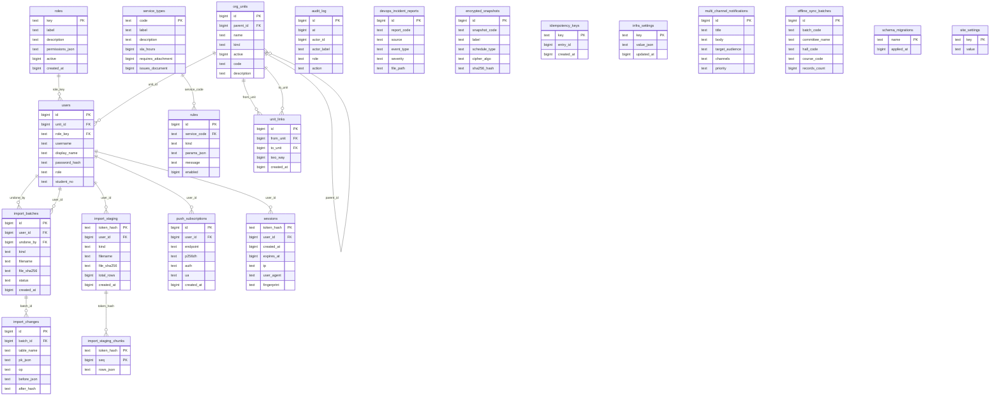
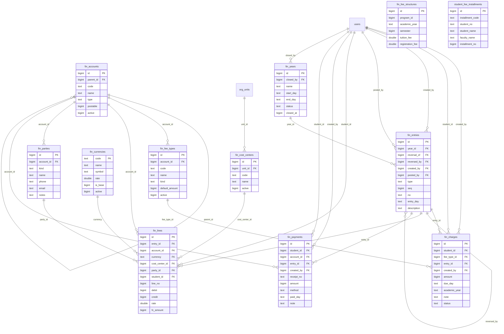
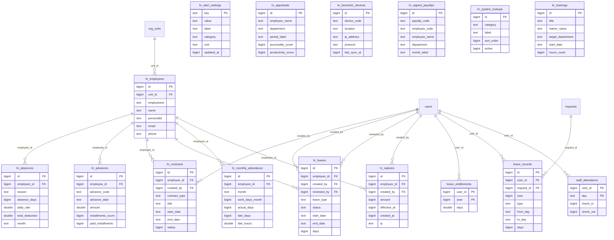
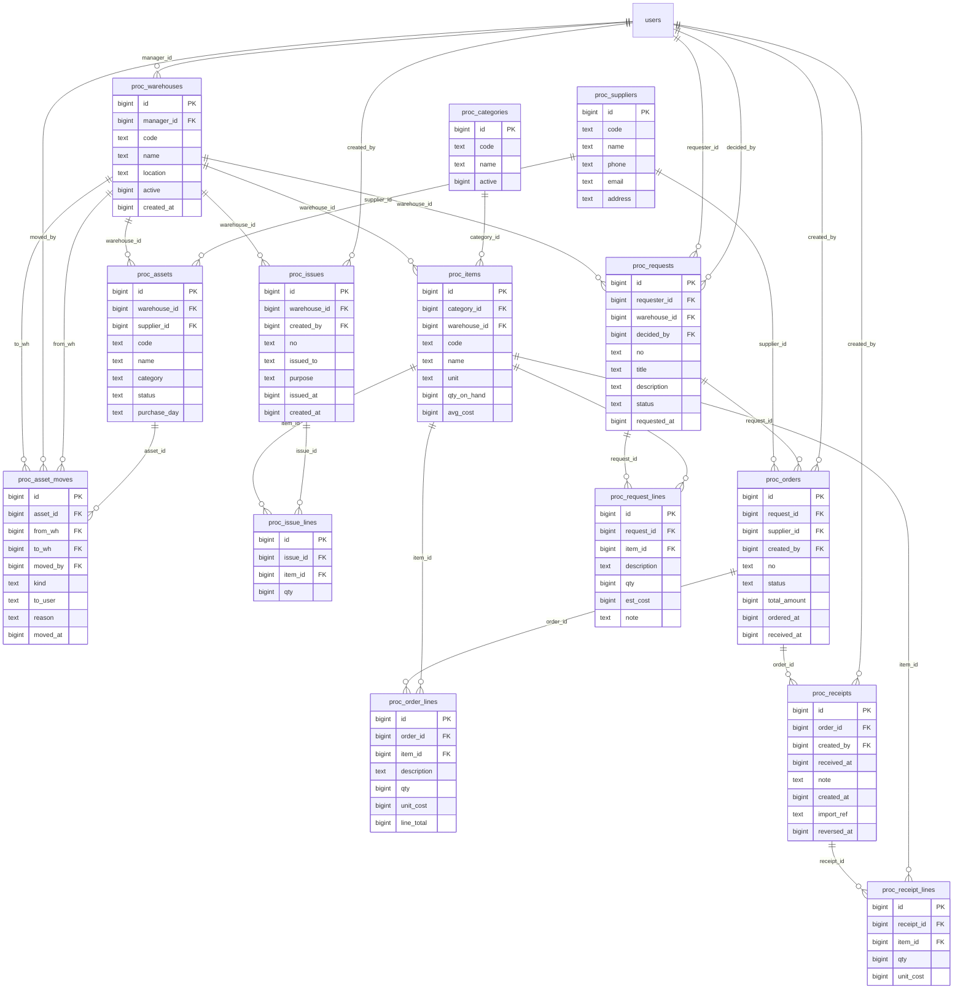
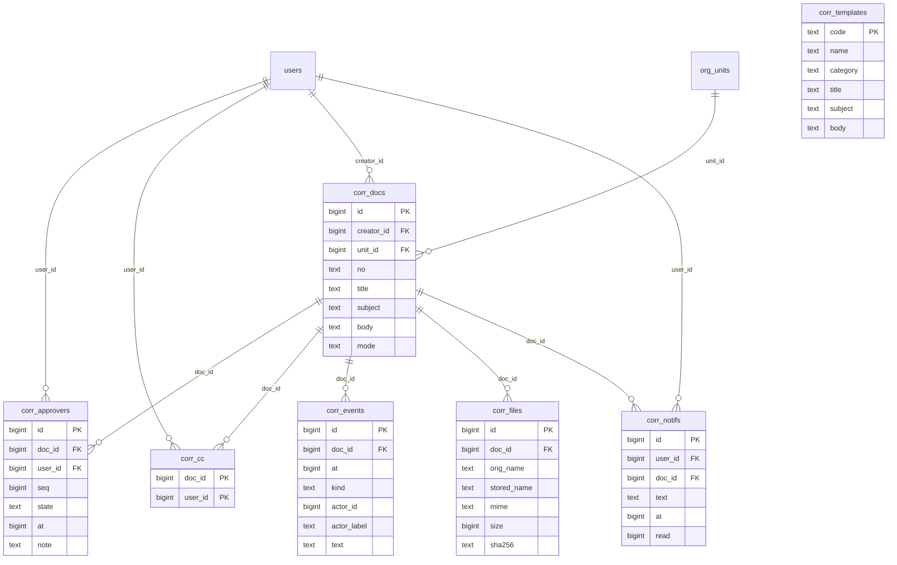
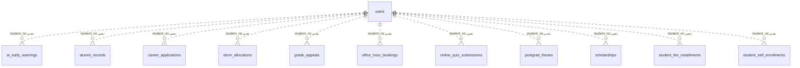

# 06. مخططات الكيانات والعلاقات

استُخرجت من بيانات تعريف قاعدة التطوير المحلية بعد تطبيق كل الترحيلات، وليست من قاعدة الإنتاج. تظهر العلاقات المعرّفة فعليًا بقيود `FOREIGN KEY`، والخطوط المتقطعة في آخر الملف علاقات نصية لا يحميها أي قيد.

لتسهيل القراءة يعرض كل كيان المفتاح الأساسي والمفاتيح الأجنبية وحتى خمسة أعمدة أخرى. الأعمدة كاملة في [05-database-analysis.md](05-database-analysis.md).

## الهوية والصلاحيات والنظام (21 جدولًا)

## الطلاب والقبول والخدمات (35 جدولًا)

```mermaid
erDiagram
  requests ||--o{ academic_request_details : "request_id"
  courses ||--o{ academic_request_details : "target_course_id"
  programs ||--o{ academic_request_details : "target_program_id"
  requests ||--o{ attachments : "request_id"
  users ||--o{ card_batches : "created_by"
  card_batches ||--o{ card_handovers : "batch_id"
  users ||--o{ card_handovers : "handed_by"
  users ||--o{ card_handovers : "student_id"
  career_jobs ||--o{ career_applications : "job_id"
  users ||--o{ complaints : "responded_by"
  users ||--o{ complaints : "student_id"
  documents ||--o{ document_pdfs : "code"
  users ||--o{ documents : "issued_by"
  requests ||--o{ documents : "request_id"
  dorm_rooms ||--o{ dorm_allocations : "room_id"
  users ||--o{ news : "created_by"
  news ||--o{ news_media : "news_id"
  requests ||--o{ request_events : "request_id"
  org_units ||--o{ requests : "assigned_unit_id"
  users ||--o{ requests : "decided_by"
  service_types ||--o{ requests : "service_code"
  users ||--o{ requests : "student_id"
  users ||--o{ student_certs : "student_id"
  users ||--o{ student_file_meta : "audited_by"
  users ||--o{ student_file_meta : "student_id"
  users ||--o{ student_file_meta : "updated_by"
  users ||--o{ student_files : "created_by"
  users ||--o{ student_files : "student_id"
  student_groups ||--o{ student_group_members : "group_id"
  users ||--o{ student_group_members : "student_id"
  programs ||--o{ student_groups : "program_id"
  users ||--o{ student_holds : "created_by"
  users ||--o{ student_holds : "student_id"
  users ||--o{ student_profiles : "created_by"
  programs ||--o{ student_profiles : "program_id"
  users ||--o{ student_profiles : "user_id"
  academic_request_details {
    bigint request_id PK
    bigint target_program_id FK
    bigint target_course_id FK
    text request_category
    bigint target_grade_id
    bigint claimed_mark
    text violation_type
    text justification
  }
  alumni_records {
    bigint id PK
    text student_no
    text full_name
    text faculty_name
    text program_name
    bigint grad_year
  }
  attachments {
    bigint id PK
    bigint request_id FK
    text orig_name
    text stored_name
    text mime
    bigint size
    text sha256
  }
  card_batches {
    bigint id PK
    bigint created_by FK
    text label
    text filter_json
    bigint created_at
  }
  card_handovers {
    bigint id PK
    bigint batch_id FK
    bigint student_id FK
    bigint handed_by FK
    bigint received_at
    text receiver_name
    text note
  }
  career_applications {
    bigint id PK
    bigint job_id FK
    text applicant_name
    text student_no
    double gpa
    text cv_summary
    text status
  }
  career_jobs {
    bigint id PK
    text title
    text company_name
    text sector
    text location
    text job_type
  }
  complaints {
    bigint id PK
    bigint student_id FK
    bigint responded_by FK
    text no
    text subject
    text body
    text status
    text response
  }
  document_pdfs {
    text pdf_sha256 PK
    text code FK
    bigint created_at
  }
  documents {
    bigint id PK
    bigint request_id FK
    bigint issued_by FK
    text code
    bigint issued_at
    text payload_json
    text content_hash
    text signature
  }
  dorm_allocations {
    bigint id PK
    bigint room_id FK
    text student_name
    text student_no
    text faculty_name
    text check_in_date
    text academic_year
  }
  dorm_rooms {
    bigint id PK
    text building_name
    text room_no
    bigint floor_no
    bigint capacity
    bigint occupied
  }
  news {
    bigint id PK
    bigint created_by FK
    text title
    text body
    bigint pinned
    bigint published_at
  }
  news_media {
    bigint id PK
    bigint news_id FK
    text kind
    text source
    text file
    text mime
    bigint size
  }
  office_hour_bookings {
    bigint id PK
    text faculty_name
    text student_name
    text student_no
    text slot_day
    text slot_time
  }
  request_events {
    bigint id PK
    bigint request_id FK
    bigint at
    text actor_label
    text text
  }
  requests {
    bigint id PK
    bigint student_id FK
    text service_code FK
    bigint decided_by FK
    bigint assigned_unit_id FK
    text no
    text details_json
    text status
    text reject_reason
    text rejected_by
  }
  sa_advising_warnings {
    bigint id PK
    bigint student_id
    text warning_type
    text severity
    double gpa_snapshot
    double absence_rate
  }
  sa_applicants {
    bigint id PK
    text application_no
    text full_name
    text national_id
    text phone
    text hs_type
  }
  sa_card_activity_logs {
    bigint id PK
    bigint student_id
    text student_no
    text student_name
    text event_type
    text location_name
  }
  sa_course_prerequisites {
    bigint id PK
    bigint course_id
    bigint prereq_course_id
    double min_mark
  }
  sa_credit_equivalences {
    bigint id PK
    bigint student_id
    text source_university
    text external_course_code
    text external_course_name
    bigint external_hours
  }
  sa_desk_appointments {
    bigint id PK
    text ticket_no
    bigint student_id
    bigint request_id
    text service_purpose
    text appointment_date
  }
  sa_disciplinary_details {
    bigint id PK
    bigint hold_id
    bigint student_id
    text committee_decision_no
    text violation_category
    text penalty_level
  }
  sa_lifecycle_movements {
    bigint id PK
    text movement_no
    bigint student_id
    text movement_type
    text academic_year
    bigint semester
  }
  sa_scholarships {
    bigint id PK
    text grant_no
    bigint student_id
    text scholarship_type
    double discount_percent
    double amount
  }
  scholarships {
    bigint id PK
    text student_name
    text student_no
    text program_name
    text scholarship_type
    bigint discount_percent
  }
  student_activities {
    bigint id PK
    text club_name
    text title
    text category
    text event_date
    text location
  }
  student_certs {
    bigint id PK
    bigint student_id FK
    text code
    text payload_json
    text payload_sha256
    text pdf_sha256
    text file
  }
  student_file_meta {
    bigint student_id PK
    bigint audited_by FK
    bigint updated_by FK
    text general_notes
    text box_no
    text dossier_no
    text cert_notes
    text exception_note
  }
  student_files {
    bigint id PK
    bigint student_id FK
    bigint created_by FK
    text kind
    text file
    text orig_name
    text mime
    bigint size
  }
  student_group_members {
    bigint id PK
    bigint group_id FK
    bigint student_id FK
    bigint added_at
  }
  student_groups {
    bigint id PK
    bigint program_id FK
    text name
    text kind
    text notes
    bigint created_at
    bigint updated_at
  }
  student_holds {
    bigint id PK
    bigint student_id FK
    bigint created_by FK
    text hold_type
    text note
    bigint active
    bigint created_at
    bigint cleared_at
  }
  student_profiles {
    bigint user_id PK
    bigint program_id FK
    bigint created_by FK
    text first_name
    text father_name
    text last_name
    text mother_name
    text name_en
  }
```

## الأكاديمي والامتحانات والتعلم (29 جدولًا)

```mermaid
erDiagram
  courses ||--o{ course_schedules : "course_id"
  faculty_members ||--o{ courses : "member_id"
  programs ||--o{ courses : "program_id"
  org_units ||--o{ faculty_members : "unit_id"
  users ||--o{ faculty_members : "user_id"
  users ||--o{ grade_changes : "actor_id"
  users ||--o{ grades : "approved_by"
  courses ||--o{ grades : "course_id"
  users ||--o{ grades : "entered_by"
  users ||--o{ grades : "reviewed_by"
  users ||--o{ grades : "student_id"
  courses ||--o{ hall_logs : "course_id"
  users ||--o{ hall_logs : "recorded_by"
  users ||--o{ hall_logs : "student_id"
  library_books ||--o{ library_loans : "book_id"
  lms_lectures ||--o{ lms_lecture_files : "lecture_id"
  faculties ||--o{ programs : "faculty_id"
  ai_advisor_chats {
    bigint id PK
    text user_label
    text question
    text answer
    text model_used
    bigint created_at
  }
  ai_early_warnings {
    bigint id PK
    text student_no
    text student_name
    text program_name
    double gpa
    bigint attendance_rate
  }
  ai_triage_logs {
    bigint id PK
    text source_type
    text sender_name
    text subject
    text body_text
    text ai_category
  }
  course_schedules {
    bigint id PK
    bigint course_id FK
    bigint day
    bigint start_min
    bigint end_min
    text hall
    bigint group_id
  }
  courses {
    bigint id PK
    bigint program_id FK
    bigint member_id FK
    bigint level
    bigint semester
    text name
    text code
    bigint hours
  }
  exam_schedules {
    bigint id PK
    text course_code
    text course_name
    text program_name
    text exam_type
    text exam_date
  }
  faculties {
    bigint id PK
    text name
    text name_en
    text code
    text kind
    bigint active
  }
  faculty_members {
    bigint id PK
    bigint unit_id FK
    bigint user_id FK
    text name
    text rank
    text specialty
    text email
    text phone
  }
  faculty_overload_records {
    bigint id PK
    text instructor_name
    text academic_rank
    text faculty_name
    bigint quorum_hours
    bigint actual_teaching_hours
  }
  faculty_promotions {
    bigint id PK
    text faculty_name
    text specialty
    text current_rank
    text target_rank
    double research_points
  }
  grade_appeals {
    bigint id PK
    text student_no
    text student_name
    text course_code
    text course_name
    double old_mark
  }
  grade_changes {
    bigint id PK
    bigint actor_id FK
    bigint grade_id
    bigint student_id
    text course
    text action
    bigint old_total
  }
  grades {
    bigint id PK
    bigint student_id FK
    bigint course_id FK
    bigint entered_by FK
    bigint reviewed_by FK
    bigint approved_by FK
    text term
    text course
    bigint hours
    bigint mark
    bigint level
  }
  hall_logs {
    bigint id PK
    bigint student_id FK
    bigint course_id FK
    bigint recorded_by FK
    text kind
    text subject
    text hall
    bigint entered_at
    bigint exited_at
  }
  library_books {
    bigint id PK
    text isbn
    text title
    text author
    text category
    bigint publish_year
  }
  library_loans {
    bigint id PK
    bigint book_id FK
    text borrower_name
    text borrower_no
    text loan_date
    text due_date
    text return_date
  }
  lms_lecture_files {
    bigint id PK
    bigint lecture_id FK
    text filename
    text kind
    text mime
    bigint size
    text file
  }
  lms_lectures {
    bigint id PK
    text course_code
    text course_name
    text title
    text kind
    bigint week_no
  }
  lms_quizzes {
    bigint id PK
    text course_code
    text course_name
    text title
    bigint duration_min
    bigint total_marks
  }
  online_quiz_submissions {
    bigint id PK
    bigint quiz_id
    text student_no
    text student_name
    double score
    bigint total_marks
  }
  online_quizzes {
    bigint id PK
    text course_code
    text course_name
    text title
    text instructor_name
    bigint duration_min
  }
  postgrad_theses {
    bigint id PK
    text student_no
    text student_name
    text degree
    text program_name
    text title
  }
  programs {
    bigint id PK
    bigint faculty_id FK
    text faculty
    text name
    text degree
    bigint years
    bigint active
  }
  qa_accreditations {
    bigint id PK
    text program_name
    text agency_name
    text standard_code
    bigint self_study_progress
    text audit_date
  }
  qa_kpis {
    bigint id PK
    text code
    text title
    text standard_domain
    double target_value
    double actual_value
  }
  qa_surveys {
    bigint id PK
    text course_code
    text course_name
    text instructor_name
    text semester
    bigint responses_count
  }
  research_projects {
    bigint id PK
    text code
    text title
    text principal_investigator
    text faculty_name
    text domain
  }
  smart_schedule_slots {
    bigint id PK
    text course_code
    text course_name
    text faculty_name
    text instructor_name
    text hall_code
  }
  student_self_enrollments {
    bigint id PK
    text student_no
    text student_name
    text course_code
    text course_name
    bigint credits
  }
```

## المالية (12 جدولًا)

## الموارد البشرية (16 جدولًا)

## المشتريات والمخازن (14 جدولًا)

## المراسلات (7 جدولًا)

## علاقات نصية بلا قيد

هذه الجداول تربط الطالب برقمه الجامعي `student_no` نصًا، ولا تحوي `student_id`، فلا يمنع شيء من وجود سجل يتيم أو خطأ عند تغيّر الرقم.

وهذه أعمدة تنتهي بـ`_id` وتبدو مراجع، لكن لا يحميها قيد مفتاح أجنبي: `academic_request_details.target_grade_id`، `audit_log.actor_id`، `corr_events.actor_id`، `course_schedules.group_id`، `exam_schedules.group_id`، `fin_fee_structures.program_id`، `grade_appeals.grade_id`، `grade_changes.grade_id`، `grade_changes.student_id`، `idempotency_keys.entry_id`، `online_quiz_submissions.quiz_id`، `sa_advising_warnings.student_id`، `sa_applicants.national_id`، `sa_applicants.pref1_program_id`، `sa_applicants.pref2_program_id`، `sa_applicants.pref3_program_id`، `sa_applicants.accepted_program_id`، `sa_applicants.enrolled_student_id`، `sa_card_activity_logs.student_id`، `sa_card_activity_logs.terminal_id`، `sa_course_prerequisites.course_id`، `sa_course_prerequisites.prereq_course_id`، `sa_credit_equivalences.student_id`، `sa_credit_equivalences.internal_course_id`، `sa_desk_appointments.student_id`، `sa_desk_appointments.request_id`، `sa_disciplinary_details.hold_id`، `sa_disciplinary_details.student_id`، `sa_lifecycle_movements.student_id`، `sa_lifecycle_movements.from_program_id`، `sa_lifecycle_movements.to_program_id`، `sa_scholarships.student_id`، `sa_scholarships.fin_charge_id`، `student_profiles.national_id`.
