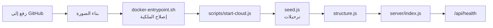

# 13. البنية التحتية والنشر

**المصدر:** ملفات المستودع وما عرضه المالك من إعدادات Railway. لم يُفحص حساب الاستضافة. القيم السرية لا تُذكر.

## الوضع الحالي

| الجانب | الحالة |
|---|---|
| الاستضافة | Railway حسب إفادة المالك، وقد تتغير إلى موقع آخر أو خادم داخلي |
| البناء | Dockerfile بالمسار `/uni-erp/Dockerfile.railway` |
| نظام التشغيل | Alpine داخل الحاوية، ومضيف Railway **UNKNOWN** |
| خادم الويب | Node مباشرة. لا Nginx في المستودع، وRailway يوفر الوسيط وTLS **حسب المعتاد، UNVERIFIED** |
| المنفذ | `PORT` من البيئة، و3000 افتراضيًا |
| قاعدة البيانات | خدمة PostgreSQL ضمن المشروع، بعنوان داخلي |
| التخزين | قرص مركب حسب سجل النشر الذي عرضه المالك |
| عدد النسخ | واحدة. **يجب أن تبقى واحدة،** انظر أدناه |
| CI/CD | لا يوجد. النشر عند الرفع إلى GitHub |
| بيئات منفصلة | لا يوجد ملف يصف بيئة اختبار. والإنتاج مسمى `production` في Railway. اسم الخدمة وقيم `suss-test` توحي باختبار، والحقيقة **UNKNOWN** |

## مسار التشغيل

**نقطة فشل:** أي خطأ في الترحيلات يوقف الإقلاع، كما حدث في الترحيل `029`.

## المتغيرات

المرجع الكامل [DEPLOYMENT.md](../uni-erp/DEPLOYMENT.md).

| المتغير | الضرورة | ملاحظة من الإعدادات المعروضة |
|---|---|---|
| `DATABASE_URL` | إلزامي | كان نصًا صريحًا، ونُصح باستخدام مرجع |
| `PUBLIC_URL` | لازم | كان `suss-test`، وهذا ليس رابطًا، فروابط التحقق وQR خاطئة |
| `UNIVERSITY_NAME` أو `Uni_name` | اختياري | القيمة بلا حروف عربية تُتجاهل |
| `BACKUP_PASSPHRASE` | موصى به بشدة | لم يظهر |
| `BACKUP_PUT_URL` | موصى به | لم يظهر |
| `SEED_PASSWORD` | عند أول إنشاء | |
| `COOKIE_SECURE`، `TRUST_PROXY`، `NODE_ENV` | تضبطها الصورة | **إذا نُشر دون هذه الصورة فيجب ضبطها يدويًا** |

## الحاويات

| البند | الملاحظة |
|---|---|
| المستخدم | يبدأ root ليصلح الملكية ثم ينزل إلى `node` عبر `su-exec`. **يبقى root احتياطيًا إذا فشل اختبار الكتابة،** `docker-entrypoint.sh` |
| `HEALTHCHECK` | غير معرف في Dockerfile. `railway.json` يستخدم `/api/health` بمهلة 60 ثانية |
| حدود الموارد | لا حدود في الملفات. `--max-old-space-size=512` في `Dockerfile.railway` فقط، والنسخة الأخرى بلا حد |
| القرص | `VOLUME /app/data` في `uni-erp/Dockerfile` فقط |
| `.dockerignore` | يستبعد `data` و`node_modules` و`.env` و`.git` |
| شبكة Docker | لا Compose. لا منافذ قاعدة بيانات مكشوفة من ملفات المستودع |

## لماذا نسخة واحدة فقط

هذه الحالة في ذاكرة العملية، ولا تشارك بين نسختين:

- حدود المعدل وسجل WAF.
- ذاكرة الجلسات، وحتى 25 ثانية من الحالة القديمة بعد سحب صلاحية.
- آخر بصمة في سجل التدقيق، فكاتبان متزامنان يكسران السلسلة، `heavy.js:44`.
- المرفقات على قرص محلي.
- قفل النسخ الاحتياطي والمجدول.

## النسخ الاحتياطي والاستعادة

| البند | الحالة |
|---|---|
| التلقائي | مرة يوميًا حول `BACKUP_HOUR`، مفعّل افتراضيًا |
| الاحتفاظ | 14 نسخة |
| المحتوى | `pg_dump` مع ملفات `data` ومفتاح التوقيع |
| التشفير | AES-256-GCM **فقط** مع `BACKUP_PASSPHRASE` |
| الموقع | قرص الخادم نفسه ما لم يُضبط `BACKUP_PUT_URL` |
| الاستعادة | `scripts/restore.js`. وزر التحقق يفك النسخة ويطابق بصمتها فقط، ولا يجرب استعادتها فعليًا، `backup.js` |
| اختبار استعادة في الإنتاج | **UNVERIFIED** |

**الخطر الأساسي:** قرص واحد يضم البيانات ونسخها. فقدان الخدمة أو القرص قد يفقدهما معًا. والنسخة لم تُسحب بعد خارجه ما لم يُفعل ذلك يدويًا.

## TLS والنطاق

- التطبيق نفسه لا ينهي TLS، ويتوقعه من الوسيط.
- `Strict-Transport-Security` يُرسل دائمًا، حتى على HTTP محلي.
- على خادم داخلي يلزم إضافة وسيط مثل Nginx أو Caddy، مع `TRUST_PROXY=1` و`COOKIE_SECURE=1`.
- النطاق الفعلي **UNKNOWN**.

## السجلات والمراقبة

| البند | الحالة |
|---|---|
| سجل التطبيق | ملف JSON يومي في `data/logs`، مع المخرج القياسي |
| التنبيهات | لا يوجد تنبيه خارجي عند عطل |
| القياس | لوحة داخلية للأداء، تُفقد قيمها عند إعادة التشغيل |
| تتبع الأخطاء | لا Sentry أو ما يشابهه |
| تدقيق الأعمال | `audit_log` |

## ملفات مكررة

ثلاثة Dockerfile، وملفا `railway.json` و`docker-entrypoint.sh`، ونسختا `start-cloud.js`. نسخ الجذر قد تُفعَّل بالخطأ عند تغيير الإعداد. الأفضل إبقاء مسار نشر واحد موثق.

## فصل البيئات

**لا فصل موثق.** لا توجد بيئة اختبار بقاعدة منفصلة في المستودع. فكل نشر يذهب مباشرة إلى البيانات الحقيقية، وتطبق ترحيلاته فورًا.

## أولويات

1. نسخة خارجية مشفرة وتجربة استعادة.
2. بيئة اختبار منفصلة بنسخة مجهولة البيانات.
3. مراقبة خارجية وتنبيه عند توقف الصحة.
4. CI يشغّل الاختبارات قبل النشر.
5. توحيد ملفات النشر.
